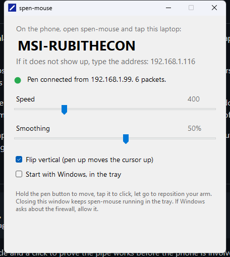
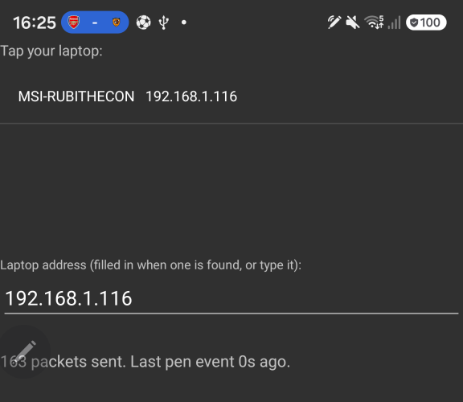

# spen-mouse

An air mouse for Windows, powered by the Galaxy S Pen. Hold the button, wave the pen, the cursor follows. Tap the button to click.

Inspired by [AirPointer](https://github.com/musubipapi/airpointer), which did this with a closed AirPods case and a lot of reverse engineering. The S Pen version is easier: Samsung publishes an [SDK](https://developer.samsung.com/galaxy-spen-remote/s-pen-remote-sdk.html) that streams the pen's motion to the phone.

Two parts: an Android app that forwards the pen's air-motion deltas and button presses over UDP, and a Windows tray app that turns them into cursor movement with `SendInput`. The receiver announces itself on the LAN, so the phone finds it without anyone typing an address.

Status: works. Hold the pen button to move, tap it to click, release it to reposition your arm (the cursor stays put, like lifting a mouse).

## Install (no developer tools needed)

Both devices must be on the same Wi-Fi. Phone hotspots often block laptop-to-phone traffic, so use a normal network.

**On the laptop**

1. Download `SpenMouse.exe` from the [latest release](https://github.com/digidan-za/spen-mouse/releases/latest) and run it.
2. Windows SmartScreen will say the app is unrecognised, because it is not code-signed. Click "More info", then "Run anyway".
3. When Windows Firewall asks, click "Allow". The app needs to receive on the network.
4. Close the window when you like; spen-mouse keeps running in the tray. Tick "Start with Windows" if you want it there always.

**On the phone** (Galaxy with an S Pen that supports Air actions: Note 10 and later, S22 Ultra and later)

1. Download `spen-mouse.apk` from the same release page, on the phone, and open it. Allow installs from your browser if asked.
2. Open spen-mouse. Allow "local network access" when asked; without it the app cannot reach the laptop.
3. Your laptop appears in the list within a few seconds. Tap it if there is more than one.
4. Pull the pen out, hold its button and wave. Tap the button to click.

If the laptop never appears, type the address the receiver window shows. If the pen goes quiet, press its button once; if it stays dead, dock the pen for a few seconds and pull it out again.

## Building from source

### Windows receiver

    cd windows
    dotnet run                       # the tray app
    dotnet publish -c Release -o publish   # one self-contained SpenMouse.exe

`.ake-pen.ps1` sends a circle and a click from the laptop itself, to prove the pipe works before the phone is involved.

### Android forwarder

Needs the [S Pen Remote SDK](https://developer.samsung.com/galaxy-spen-remote/s-pen-remote-sdk.html)
(free Samsung developer login). Unzip it and copy `spenremote-v1.0.1.jar` and `sdk-v1.0.0.jar` into
`android/app/libs/`. They are git-ignored. Then open `android/` in Android Studio, or:

    cd android
    ./gradlew installDebug

Type the laptop's IP into the box, hold the pen button, wave. The phone and laptop must be on the same Wi-Fi.

A release build is signed with `android/keystore.properties` and the keystore it names, both git-ignored; without them you get a debug build, which installs fine.

## Things that bit

- **Android 16+ blocks LAN traffic** until the app holds the `ACCESS_LOCAL_NETWORK` runtime permission. Accept the prompt on first launch, or every packet silently fails.
- **The pen hangs up after a minute** if an app keeps the SDK's air-motion listener registered: that puts the pen's gyro in always-on mode and drains it. This app registers for motion only while the button is in use. Docking the pen resets its mode; one button press re-arms it.
- **Discovery needs laptop-to-phone traffic.** The receiver broadcasts a beacon and also answers direct probes, but a phone hotspot that isolates its clients blocks both. Manual address entry still works there, because phone-to-laptop traffic usually does.
- **Decimal commas.** The protocol is text, so both ends format and parse with an invariant locale.

The full build log, including the wrong turns, is in [NOTES.md](NOTES.md).

## Prior art

- [musubipapi/airpointer](https://github.com/musubipapi/airpointer), the AirPods-case air mouse that started the idea.
- [th3-s7r4ng3r/SPEN-To-PC](https://github.com/th3-s7r4ng3r/SPEN-To-PC), phone-to-PC S Pen gestures over TCP.
